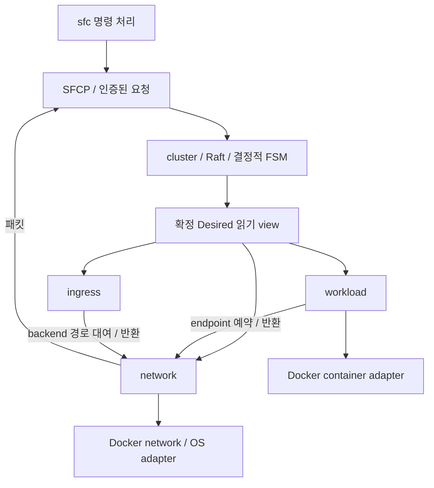

# 모듈·소유권 설계

이 문서는 Go 내부 package의 책임과 상태·자원 소유권을 설명한다. package 분리가 별도 데몬/서비스/DB를 강제하지 않는다. 전환 결과와 검증 환경의 범위는 [Go 구현 결과](go-rewrite-outcome.md)를 따른다.

`observability`는 서명된 측정 DTO·CPU delta·승인된 파일시스템 측정만 담당한다. `app`이 현재 멤버/로컬 자원과 SDK에 연결하고 관측 DB를 소유하며, `control`은 현재 사용자/tenant/node/root 권한으로 공개 projection을 만든다. 이 package에 합의·배치·실행 권한이나 별도 데몬을 두지 않는다. [관측 경계](../reference/node-observations.md)를 따른다.

## 실행과 기능 범위

논리 노드당 `sfcd` 하나가 필수 cluster/SFCP와 선택 network·workload·ingress를 구성한다. control 여부는 Raft 투표 구성의 속성이며 역할별 데몬 모드가 아니다. CLI `sfcli`는 자기 설정을 읽고 SFCP 관리 API를 호출한다. CLI 명령 해석·출력·종료 코드는 각 실행 파일에 둔다.

산출물은 `sfcli`·`sfcd` 두 Go 실행 파일과 공유 내부 package다. 새 구현은 `libsfc.so`/외부 C++ ABI를 제공하지 않는다.

현재 기능은 과반수 관리·인계·노드별 운영 데이터·Docker·다중 CIDR/TUN·HTTP/1.1·2·3/로컬 TLS다. HTTP 인스턴스는 여러 listener를 가질 수 있다. 일반 TCP/UDP 공개·다단계 worker 프로세스·ACME/Certbot은 후속 범위다. 후속 자식 프로세스는 Go runtime 안의 임의 fork 대신 새 실행 상태를 갖는 exec 경계를 사용한다. 다중 노드 기능과 서로 다른 물리 호스트의 장애 독립성 검증은 구분한다. 최종 환경은 같은 물리 호스트의 독립 Linux KVM 게스트2개다.

입력의 책임은 [관리 명령과 앱 선언](commands-and-declarations.md)을 따른다. 명시 운영 작업과 app.yaml 목표 상태는 같은 권한·Raft·Inventory 코어를 사용한다. 로컬 관리는 기본 `/run/sfcdp.sock`의 TLS/SFCP Unix socket으로 User/SecretInput을 제공한다. 노드 간 QUIC/UDP SFCP와 같은 사용자 관리 코어를 사용하며 [Docker의 HTTP Unix API와 구분](../reference/unix-sockets.md)한다.

## 컨테이너 앱 소스 배치

컴파일러와 컨테이너 앱의 소스·이미지 정의·entrypoint·빌드 자료는 [apps/<컨테이너 이름>/](../../apps/README.md)에 둔다. `apps/lifecycle-compiler/`, `apps/php/`, `apps/mysql/`, `apps/dockerbackend/`를 사용한다. 시험 orchestration은 `tests/`, app.yaml/cluster.yaml 배포 예시는 `docs/examples/`에서 관리한다. node의 실제 tenant/job workspace·Volume·cache 경로와 저장소 소스 배치는 서로 다른 경계다.

## 기능 모듈 네 개

| 모듈 | 맡는 것 | 소유하는 상태/자원 | 맡지 않는 것 |
|---|---|---|---|
| **cluster** | 가입·투표 구성·관리 명령·권한/CAS·결정적 FSM·최신/로컬 조회·Raft log/Snapshot | 확정 Desired·관리 공개키/권한·요청 중복 결과·FSM 위치·Raft term/vote/log·공유 상태 Snapshot | Docker/커널/HTTP 부작용, 자체 합의나 별도 체인 동기화 |
| **network** | IPAM의 로컬 적용·Bridge/TUN·route/nft·패킷 전달·경로/MTU 관측·endpoint 예약/대여·Drain | 자기 노드의 네트워크 journal/Applied/Observed·장치/규칙/Bridge·flow·endpoint lease | 전역 관리 변경의 독자 확정, 컨테이너 task 실행 |
| **workload** | 확정된 task의 이미지/컨테이너 실행·관측·자원 예약·배치 정책의 명시 제안 | 자기 노드의 task journal/Applied/Observed·컨테이너 ID·실행 자원 예약 | 자체 CIDR/TUN 조작, 로컬 관측으로 확정 Desired 덮어쓰기 |
| **ingress** | listener·TLS·HTTP/1.1·2·3·Host/Path·backend/health/분산·연결/스트림 종료 | listener/request/connection·backend lease·로컬 적용 상태와 인증서 참조 | 관리 커밋, Docker/커널 직접 변경, SFCP 신원 공유 |

배치 정책의 입력은 실제 owner의 관측이며 출력은 읽기 전용 관리 제안이다. 별도 CAS의 과반수 커밋만 Desired를 바꾼다. typed Bridge/task의 IPAM·노드 예산·의존성은 app이 주입한 결정적 validator로 확정 FSM 안에서 검사한다. 모듈 실행기는 확정 Desired와 원 journal을 소비하며 원격 관측/배치 제안이 실제 실행을 대신하지 않는다.

## 기반 경계

| 기반 | 계약 |
|---|---|
| **SFCP** | 노드 간 관리·조회·Raft·Snapshot·상태·터널 통신. 신원/목적별 허가·기한·길이/큐 예산·요청 수명. 기능 모듈이 직접 라이브러리 listener를 만들지 않음 |
| **identity** | 로컬 키/인증서·전체 공개키 검증·challenge·현재 권한 연결. 접속 성공/공개키 등록과 투표권을 구분 |
| **storage adapters** | 모듈별 내구 저장의 구현. 임의 공용 KV 접근을 다른 모듈에 주지 않음. 원자 batch/동기 저장과 오류를 숨기지 않음 |
| **Docker/OS adapters** | Docker API·Netlink·nft·TUN의 실제 I/O. 비즈니스 결정·자원 소유권은 기능 모듈에 유지 |
| **app/config** | 설정 탐색/검사·구성/시작/종료·포트 연결. 모든 업무 상태를 소유하는 중앙 상태 머신으로 만들지 않음 |

Raft engine은 control의 구체적인 애플리케이션 정책을 import하지 않는다. bootstrap/app 조립 계층이 실제 control.Policy를 source/managed 이행의 필요한 소비 메서드로 연결하고 engine은 원 replay·native index·원자 binding/receipt를 담당한다. 정책/서명 검사를 engine 안에서 복제하지 않는다.

typed legacy 정리는 원본 native Desired와 매핑/예약을 하나의 FSM patch·receipt로 변경한다. 명시 정책 authorizer가 정확한 원 source/CAS와 관련 key를 허가하고 전체 Desired validator가 수명 전이를 검증해야 한다. 이 경계에서는 존재하는 원 source의 Drain/tombstone만 허용하며 raw source 신규 생성이나 tombstone 부활을 허용하지 않는다. FSM의 정리 수락과 실제 Docker/커널 종료 증거는 구분한다.

CD metadata의 prepare/send/collect는 현재 leader가 수행하며 local Docker/network 어댑터를 요구하지 않는다. native 단계의 dispatch는 원 owner와 실제 설치 어댑터를 요구하고, metadata 확정만으로 native Healthy나 앱 전체 완료를 판정하지 않는다.

각 기능은 재사용 가능한 제품 코어와 실제 storage/identity·SFCP·Raft/FSM·Docker/OS 어댑터를 사용한다. CLI 명령 처리와 daemon 조립은 두 `cmd` 실행 파일의 책임이다.

그림은 실행 흐름/소비 관계다. Go import는 각 기능이 cluster의 **순수 읽기/모델 경계**와 소비자 쪽 작은 port에만 의존하게 한다. cluster는 network/workload/ingress 구현을 import하거나 호출하지 않는다. SFCP는 기능 구현을 import하지 않고 app에서 handler를 등록한다. network가 SFCP를 사용하면서 SFCP가 network를 import하는 순환을 만들지 않는다.

Workload와 network는 같은 Docker client를 공유할 수 있지만 객체별 writer는 하나다. **Docker network/Bridge는 network, container는 workload**가 소유한다. network가 컨테이너를 정지/삭제하지 않으며 workload가 임의 Bridge를 제거하지 않는다. Ingress는 backend descriptor/lease를 소비하며 컨테이너 DB를 읽지 않는다.

Network/Workload Manager는 각 운영 DB를 내부에 두고 Workload가 작은 BridgeProvider port로 Network의 내구 참조를 소비한다. 원 container ID의 생성/실행 단계·Engine/커널 readback·소유 불일치 거부와 제거 후 반환을 관리한다. 실제 native 상태와 과반수 Desired의 수락 상태는 별도로 판정한다.

## 저장과 복제의 경계

관리 망의 source key와 논리 packet namespace는 `tenancy.SourceIdentity`/`PacketNamespace`에서 표현한다. 이 식별자는 권한이나 native 준비 증거가 아니다. tenant catalog·현재 member/권한·정확한 source revision과 실제 owner permit은 기존 관리 경계가 확인한다. 앱은 `NetworkReference`에 고정한 source/group/hash를 소비하며 원 참조의 node-local TUN 선택은 `LocalTunnel`을 사용한다.

Task의 native Bridge/관리 망 참조를 읽는 경계는 `deployment.ResolveTaskNetwork` 하나다. control의 Task material과 Ingress가 같은 reader를 호출하며 원 Task의 tenant/app/deployment/node/owner·정확한 dependency를 대조한다. 현재 수락·quorum·실제 Acquire/Read-back은 이 reader의 책임이 아니다. `control.NativePermit`은 관리 source와 앱 source의 현재 native 사용을 판정하고, Runtime의 원 모듈 owner가 journal·외부 효과·종료를 담당한다. 내부 타입 이름과 별개로 기존 SFCP method/원 JSON·작업 ID는 그대로 보존한다.

| 상태 | 권위/쓰기 경계 | 복제 |
|---|---|---|
| 관리 Desired·공개 권한·IP/CIDR 할당·노드별 한도·요청 결과 | cluster의 결정적 FSM, 상태+결과+lastApplied 원자 적용 | Raft voter/non-voter 동일 FSM + Snapshot |
| term/vote/log·Raft 구성 | 선택한 Raft 라이브러리와 전용 store | 라이브러리 규칙; 다른 노드의 term/vote DB를 복사하지 않음 |
| Network 운영 journal/Applied/Observed | 해당 노드 network 단일 writer | 자기 노드 원본; Shared Snapshot으로 덮어쓰지 않음 |
| Workload 운영 journal/Applied/Observed | 해당 노드 workload 단일 writer | 자기 노드 원본 |
| Ingress 운영/인증서 참조·내구 대여 | 해당 노드 ingress 단일 writer | 자기 노드 원본; 비밀은 복제하지 않음 |
| 개인키·설치용 주소·CLI 설정 | 해당 설치의 로컬 소유 | 클러스터 복제 제외 |

기존 control/mgmt/node/ighttp의 **논리 저장 소유권**은 보존한다. 고정 구성에 따라 bbolt FSM/모듈 DB와 raft-boltdb 전용 log/stable 파일을 사용한다. Raft log와 FSM DB를 분리하면 둘 사이 원자성을 가정하지 않고 재생으로 복구한다.

일반 노드도 승인된 non-voter로 같은 관리 FSM과 요청 메타데이터를 복제한다. 개인키/운영 원본은 제외하며 voter만 정족수에 포함한다. 별도 projection/체인 복제 계층을 만들지 않는다.

## 상태 전이와 완료

`관리 요청 수신 → Raft 확정 → Desired 내구 적용 → 로컬 작업 준비/내구 journal → 외부 실행 → 실제 결과 정산 → Applied/Observed 게시`를 구분한다. 확정 로그의 재생은 커널/컨테이너 명령의 즉시 재실행이 아니다. 모든 모듈이 전체 로그 위치가 아니라 **자기가 소비하는 객체의 revision/generation**을 비교한다.

새 Desired가 와도 이미 dispatch한 작업의 대상/ID/결과를 유지한다. 결과 불명은 inspect/recovery 뒤 해소한다. 삭제 완료 증거와 새 생성의 generation을 별도로 보존한다. lease는 새 대여 차단·기존 사용자 정산·실제 자원 제거를 구분한다. 프로세스 종료/FD 폐쇄를 DB 정리 완료로 대체하지 않는다.

시작은 필수 identity/storage/SFCP/cluster 준비 후 선택 모듈의 의존 순서로, 종료는 신규 수락 차단→기존 작업 정산/내구 복구 필요 기록→lease 반환→자원/저장 닫기 순서다. DB/로그/외부 부작용을 한 거대 transaction으로 가정하지 않는다. 미구현/실패/복구 필요를 Ready로 표시하지 않는다.

## CIDR/IPAM·내장 DNS

CIDR/IPAM·DNS 계약은 network 모듈이 클러스터 전역 CIDR·tenant/node 소유권과 주소/참조를 통제하고, 실제 컨테이너 주소는 Docker IPAM/SDK로 설정하도록 한다. DNS는 담당 sfcd 내부에서 제공하며 별도 서버 컨테이너/daemon을 만들지 않는다. 공유 설정/주소 예약·owner CAS는 cluster, 실제 socket/query/TTL·native pin 정산은 network owner가 담당한다. 질의/cache는 로컬이고 질의마다 Raft를 쓰지 않는다. route는 양측 승인·방향/port·원 flow/native 참조를 검증하며 실제 packet provenance와 peer boot를 별도로 확인한다. CIDR/gateway/owner·DNS/운영 한도는 실행 중 명시 관리 CAS와 원 정산/새 generation으로 전환한다. DHCP 서버·UDP67·외부 client·DHCP lease/guard/전용 RPC는 범위에서 제외한다.

## Secret Group과 승인

Secret Group 계약은 cluster→tenant root→다단 Group→Secret의 접근 경계·ordered source 병합과 앱 배포 시 필요한 Group별 최초1회 검증을 정의한다. cluster는 tree/권한/참조·시점/사실/대상의 서명 승인/폐기를, secrets owner는 보호 입력·공급자/verifier·원문/keyset·mount 수명을 담당한다. 승인 서명은 provider 복호화 키나 전역 bearer 권한이 아니며 현재 정책/대상과 함께 검사한다. 원문/비밀번호/verifier는 Raft에 복제하지 않는다. CLI는 보호 입력을 실제 provider에 전달하고 원 write의 내구 결과·공유 publish를 정산한다. 앱의 원격 Secret 소비도 원 Binding·현재 permit과 owner 수명에 결합한다.

## 앱 배포·내장 CD

[app.yaml](app-and-cluster-spec.md)은 tenant의 이름 있는 앱 묶음·서비스 배치·관리 network/Secret 참조·Volume/앱 delivery 정책을 담는다. CLI와 daemon은 compose-go parser와 같은 계획/Inventory/Execution 코어를 사용한다. network/CIDR/IPAM/DNS·Group metadata·tenant registry/trust/route 변경은 관리 명령으로 실행하며 앱 CD에 합치지 않는다. [내장 CD](../mechanisms/delivery.md)는 cluster 관리 API를 소비하는 조정 경계다. 고정 Git source의 fetch/auth·후보 게시·승인/sync·runtime override·실패 복구와 자동 정책을 같은 앱 실행기에 연결한다. 앱/source/operation/inventory는 Raft 권위, 실제 운영 자원/journal은 원 모듈 owner가 유지한다. Git 읽기/정규 계획은 외부 효과와 분리하며 현재 승인/권한·과반수 확정 뒤에만 Desired를 변경한다. Argo CD의 필요한 동작을 참고하되 자체 명세를 사용하며 UI는 후속 범위다.

## tenant·사용자 격리

tenant·사용자 계약은 네 기능 모듈에 tenant-qualified 자원·권한·예산을 적용한다. cluster가 user/membership/system admin·전역 CIDR 예약·양측 route 승인·tenant별 image trust를 확정하고, password/private-key/token 사용자 인증은 node Member/Raft/Tunnel admission과 분리한다. 한 user는 여러 tenant의 역할을 가지며 system admin은 membership 없이 모든 tenant를 관리한다. 일반 사용자 API와 native endpoint/Ingress/flow 모두 tenant 경계를 검사한다. tenant별 daemon/Raft나 임의 Docker socket 접근을 제공하지 않는다.

Secret은 cluster→tenant root→다단 Group→Secret으로 격리한다. private registry는 `sfcd`가 직접 서비스하는 tenant별 OCI HTTP endpoint다. 서버 owner가 원 retained Volume writer와 TLS/인가·요청/upload 수명을 관리하고, workload의 기존 Volume/종료 정산을 재사용한다. 별도 registry 컨테이너나 bootstrap 이미지를 요구하지 않는다. tenant별 신뢰 registry/repository는 생성 시 Docker Hub만으로 초기화하고 cache/create/CD까지 적용한다. 생성한 registry의 자동 신뢰는 없다. 전체 FSM을 가진 신뢰 node의 복제와 tenant 사용자에게 허가한 조회를 구분한다.

외부 registry의 참조 선택은 순수 `imagesource` 코어, 실제 OCI 읽기는 `registryclient`, 로컬 이미지 사용/적재는 기존 `engine`이 맡는다. registryclient는 별도 daemon/DB/cache가 아닌 호출별 I/O 경계이며 현재 권한은 control·원 Secret Binding에서 판정한다. tenant CA·자격을 해당 클라이언트에만 적용하고 검증한 원 platform manifest/config·압축 layer graph를 태그 없는 OCI+Docker tar stream으로 기존 Docker SDK에 적재한다. 원 manifest와 config만 정확한 native ID로 조회하며 legacy store의 config ID 또는 containerd store의 manifest ID를 기존 Process에 고정한다. 앱 Goal/Process·원 Task/사용 참조는 기존 workload가 소유한다. [외부 registry](../reference/external-registries.md)의 현재 연결·수락 범위를 따른다.

## 이미지 빌드 컨텍스트의 내부 경계

이미지 빌드의 내부 `imagebuild`는 컨텍스트 경로/ZIP·part/seal/expiry와 scope/CAS, Dockerfile 의존과 digest 고정 정책을 담당한다. 파일 어댑터는 기존 observations DB와 등록 저장 root의 descriptor를 빌리고 bytes를 Raft에 넣지 않는다. `control`이 현재 사용자/tenant·원 operation/참조를 확정하고 `app`이 RootManager pin·유한 builder와 종료를 연결하는 책임이다. 이는 공개 명령 지원을 선언하는 API 표가 아니며 연결/수락 조건은 RQ6 계획에서 구분한다.

## bootstrap·runtime node 운영

bootstrap 계약은 독립 init/대상 cluster join을 명시 선택하고 자기 하나의 확정 구성은 같은 Raft/FSM의 standalone N1/Q1로 실행한다. 초기 앱/tenant/사용자 계정/network/Secret/volume/CD/registry 운영 catalog는 비어 있다. 필수 신원/합의/최초 관리자 등록 anchor와 앱 자원 자동 생성을 구분한다.

실행 중 node 추가/삭제/격리/복귀는 cluster가 현재 권한·구성/과반수와 내구 operation으로 조정하고 각 모듈은 원 native/flow/writer/lease/관측을 정산한다. 가입은 승인된 non-voter로 동기화한 뒤 명시 promote로 투표권을 부여한다. 격리는 vote 구성 제거가 아니며 아직 차단되지 않은 원 node를 Isolated로 보고하지 않는다. 삭제도 실제 owner closure와 원 Raft RemoveServer 결과를 확인한다. 기존 cluster의 단절을 새 standalone/원 데이터 초기화로 바꾸지 않는다. 설치·운영 명령은 [Quick-start](../quick.md)를 따른다.

## 컨테이너 lifecycle과 스크립트 실행

lifecycle 계약의 scheduler/내장 Docker 검사·Yaegi/compiled runner는 workload 기능 모듈 안에 둔다. cluster는 tenant named script/리비전·실행/resolver/빌드 정책·공유 artifact ref와 원 operation을 관리하며, deployment는 app/service mapping과 같은 Inventory/Execution을 사용한다. 스크립트는 접속 검사와 결과별 부가 동작을 커스텀하고, 담당 sfcd는 검사 결과·앱 목표/정책에 따라 Docker SDK로 시작/종료/재시작을 결정한다. compiler는 내구 job이 있을 때만 기동해 유한 batch 뒤 종료/Wait·정리한다. source/compiled cache·run journal은 각 node owner가 운영하고 원 upload/job/사용 참조를 정산한 뒤 회수한다. 별도 합의/배포 실행기·상시 compiler worker·외부 Yaegi daemon을 두지 않는다.

## 제품 계약과 샘플 앱

PHP + MySQL은 app.yaml로 배포할 수 있는 샘플 조합이다. 제품은 임의 서비스 이름/이미지·노드/포트·mount/Secret·일반 의존/health와 원 작업/자원 수명을 소비한다. PHP/PDO·SQL 문장/DB 초기화·3306/DB 데이터 경로는 샘플 이미지/fixture와 앱 선언의 책임이다. 실제 샘플의 SQL/HTTP 성공은 해당 경로의 근거이며 모든 앱의 호환/성능 보장이 아니다. 현재 source/Task/native permit 경계와 입력/fixture 매핑에 따라 범용 검사와 샘플 판정을 나눈다.
