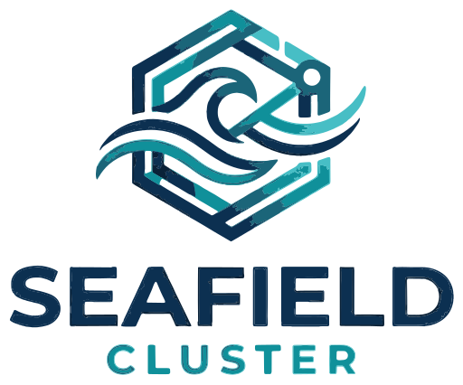
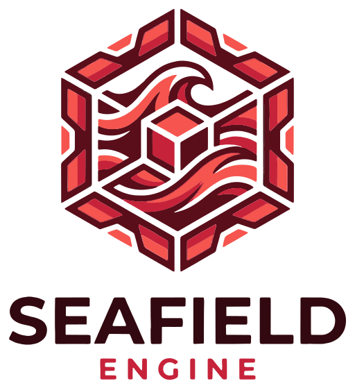

# 로고

Seafield Cluster와 Seafield Engine(`sfed`)의 로고 파일이다. 두 로고는 같은 모양 계열(육각형과 물결)이고 색으로 구분한다. 클러스터는 남색·청록, 엔진은 적갈색·빨강·산호색이다.

| | Seafield Cluster | Seafield Engine |
|---|---|---|
| 마크와 글자 |  |  |
| 마크 |  |  |
| 작은 아이콘(16·32px) |  |  |

## 파일

`cluster/`와 `engine/`에 같은 이름 규칙으로 들어 있다(`<제품>`은 `cluster` 또는 `engine`).

| 파일 | 쓰는 곳 |
|---|---|
| `seafield-<제품>-logo.svg`, `-logo-512.png`, `-logo-1024.png` | 마크와 글자. README 머리, 문서 표지 |
| `seafield-<제품>-mark.svg`, `-mark-{64,128,256,512}.png` | 마크만. 글자를 옆에 따로 쓰는 머리글, 로그인 화면 |
| `*-on-dark*` | 어두운 바탕용. 남색(클러스터)·적갈색(엔진) 부분을 밝은 색으로 바꿨다 |
| `seafield-<제품>-icon.svg`, `-icon-{16,32,48}.png`, `-favicon.ico` | 32px 이하. 큰 마크를 줄이면 뭉개져서 육각형과 물결(엔진은 큐브)만 남긴 단순한 그림이다. SVG는 브라우저가 어두운 화면이면 테두리를 밝게 바꾼다 |

## 어떻게 만들었나

마크와 글자 SVG는 원본 이미지를 색 영역별로 벡터 추적한 것이다. 원본은 그러데이션이 있는 그림이라 SVG는 색을 클러스터 5색, 엔진 4색으로 줄였다. 작은 아이콘 SVG는 손으로 그렸다. 원본 그림과 추적 스크립트는 비공개 개발 저장소 `devel/design/brand-source/`에 있다.

웹 UI는 이 파일의 복사본을 `apps/sfc-web/web/public/`(favicon)과 `apps/sfc-web/web/src/assets/brand/`(머리글·로그인 마크)에 두고 쓴다(PR #731). 로고를 바꾸면 그 복사본도 같이 바꾼다.
